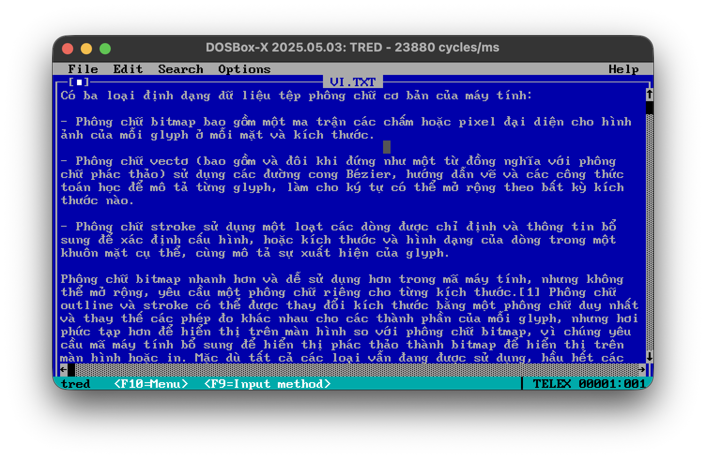

## tred - TRuong's EDitor

A Vietnamese UTF-8 text viewer and editor for MS-DOS, with a trick to draw boxes and dingbats. The idea and prototype was written in 2021 or so when there was no AI, the actual editor is written by Claude.

## Features

- Edits Vietnamese UTF-8 text files on MS-DOS with a VGA card, in an edit.com-style interface. Runs on an 8086 and up.
- Types Vietnamese with Telex or VNI like Unikey; F9 switches between Telex, VNI and off (also in the Options menu).
- Uses a BKED-style 8x14 font in 350-line text mode: Vietnamese letters live in the second VGA font, so CP437 line drawing and your normal font are left alone, and the normal text mode comes back on exit.
- Wraps long lines at word boundaries by default (Options > Word Wrap turns it off); wrapping is only on screen, the file keeps its lines.
- Keeps the file's line endings (CRLF or LF), BOM and final newline when saving.

## Usage

    tred [file]

| Key | Action |
| --- | --- |
| F9 | Switch input method: Telex, VNI, off |
| F10, Alt+F/E/S/O/H | Menus |
| Ctrl+O | Open |
| Ctrl+S | Save |
| Alt+F3 | Close the file |
| Alt+X | Exit |
| Ctrl+Y | Delete line |
| Ins | Insert / overwrite |
| Ctrl+L | Redraw the screen |

The mouse works too: click to place the cursor, use the menus, scrollbars, dialog buttons and the `[■]` close box, and scroll with the wheel if the mouse driver supports it.

Telex: `aa` â, `aw` ă, `ee` ê, `oo` ô, `ow` ơ, `uw` ư, `dd` đ, then `s f r x j` for the tones and `z` to remove one; typing a key twice undoes it (`ass` gives `as`). VNI uses `1`-`5` for tones, `6` ^, `7` horn, `8` breve, `9` đ, `0` to remove the tone.

## How it works

VGA text mode has room for only 256 characters, and CP437 fills them. tred loads a second font and repurposes the "bright" attribute bit to pick between the two, giving 512 glyphs on screen at once. See [docs/ARCHITECTURE.md](docs/ARCHITECTURE.md) for the details and what each module does.

## Building and testing

Build with Open Watcom's `wmake` in `src/`. Inside DOSBox the DOS-hosted tools in `binw` work; `tools/dosbuild.sh` does a clean build in DOSBox-X, and `tools/dosrun.sh` runs tred with a key script and dumps the screen for `tools/vgarender.py`.

`tred -k keys.txt file` replays keystrokes from `keys.txt` (characters plus tokens like `{Enter}`, `{Down}`, `{C-S}`, `{F9}`), then exits and leaves the screen as it is, for automated checks.

The input method and text buffer have host tests:

    cc -Isrc -o t_ime tests/t_ime.c src/ime.c src/utf8.c && ./t_ime
    cc -Isrc -o t_textbuf tests/t_textbuf.c src/textbuf.c && ./t_textbuf

The font is generated from `tools/bked_glyphs.txt` by `tools/mkfont.py`.

## Why?

... why not? Programming for MS-DOS is fun.

## Acknowledgements

- [TECH Help Manual](http://www.techhelpmanual.com/)
- [Code page 437](https://en.wikipedia.org/wiki/Code_page_437)
- [VileR's FRAPT](https://int10h.org/blog/2019/05/fontraption-vga-text-mode-font-editor/)
- [OpenWatcom-VSCode](https://github.com/intbeam/watcom-vscode)
- [Code page 437 to Unicode - Lookup table](https://stackoverflow.com/questions/45375804/converting-char-from-cp437-encoding-to-utf-8-encoding-always-yields-the-same-cha)
- [VileR's int10h page](https://int10h.org/)
